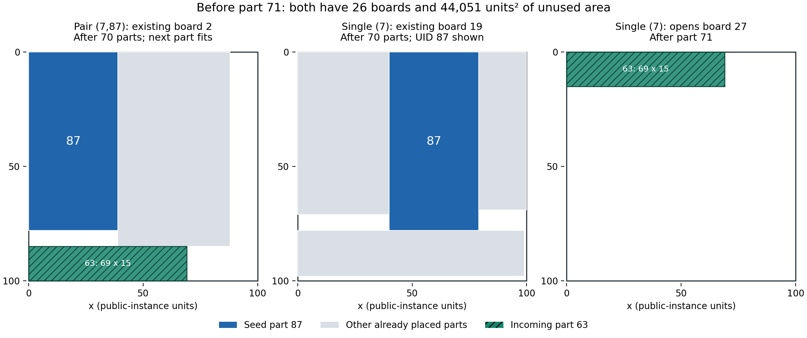

# 单件无增益、两件共同前置省板：CLASS07固定序列机制对照

2026-11-26。停止追加剪枝和提速，转向解释已有受限前缀正例。**27张是11月16日的旧见证；本次新增证据是倒序控制、冷重放复现、相同余件条件下的轨迹对照及关键落位。** 这不是新的搜索方法或工业利用率成果。

## 对照与条件

只使用已参与开发的公开`cl_07_100_01`，100×100板、100件、固定方向、零修边、零刀缝。原始CLASS成员和转换CSV经源数据核对；工厂不考虑纹理、修边5、刀径6的设置不变，也未在本轮运行。

五条给定完整序列：短边基准H；单件前缀7；单件前缀87；两件前缀(7,87)；倒序(87,7)。前置后余件均保持同一H顺序。每条从空布局、空缓存的当前解码器冷重放一次，几何配置完全相同。

前四条已有完整记录，必须逐项复现全部UID序列、布局、评分和摘要后，才执行此前未在本对照评价的倒序。前四条按seed20261126固定为87→H→7→(7,87)，最后执行(87,7)。这是一个确定性案例的五种给定干预，不是五个独立样本，也不是相同评价预算的方法竞赛。

| 给定前缀 | 最终板数 | 净利用率 |
| --- | ---: | ---: |
| 空前缀/H | 28 | 84.269286% |
| (7) | 28 | 84.269286% |
| (87) | 28 | 84.269286% |
| (7,87) | 27 | 87.390370% |
| (87,7) | 27 | 87.390370% |

所有五条保存布局均通过源数据几何、身份、朝向、摘要和评分复核。不能将给定已知答案的一次重放，写成比原第673次新序列评价更高的搜索效率。

## 新取得的机制证据

**这个例子体现联合收益，而非两个单件收益相加。** 7单独前置和87单独前置都不省板，二者共同前置省1张。此前完整K1诊断也没有任何单件省板候选。这里只支持本例，不推断一般前缀组合均有这种收益。

**不是这两件在同板贴合更紧。** 7为96×25，87为39×78，固定方向下宽之和135、高之和103，都超过板边100，不能同板并排或上下放置。已知方案确实把7和87放在两张不同的种子板上。

**本例不需要靠这两件的先后次序解释省板。** 正反两种前缀放完两件后，后续98件顺序相同；交换板号后，每一步的逐件几何一致，最终27张布局也一致。该事实由保存快照及按“已放零件不移动”从完整UID坐标独立重建的逐步几何核对支持。它不是完整缓存状态等价证明，也不能推广为所有前缀可忽略顺序：解码器仍有板位置平局规则。

## 同样的未占面积，不同的余件接纳能力

两件前缀与单件7在放完33件后，已放UID集合相同、后续67件完全相同；双方都用了19张板，已放面积均为144287。区别在各板空间的分配。

处理到第71件前，双方又都用了26张板，未占用总面积均为44051。同一件UID63、尺寸69×15到达时：

- 两件前缀把它放入已有板2的(0,85)位置。
- 单件7按当前解码器无法在旧板上落位，打开板27并放在(0,0)。现有解码键总是优先选择可行旧板，因此此处新开板不是主动牺牲板数换次级评分。

图使用保存的公开算例原始坐标。左图绿色为第71件的下一次实际落位；中图仅展示单件方案中UID87所在的旧板19，并不代表全部26张旧板；右图为该件在新板27上的实际落位。此图不表示工厂毫米尺寸或6毫米刀缝布局。

最终两件方案与单件7有20张完全相同的UID/坐标板布局。除去这20张后，**同一组余件在单件方案中占8张，在两件方案中占7张**。这是对两份完整布局差异的描述，不是算法执行了一个8板局部修复。

另一个诊断点：放完相同33件时，当前平均平方利用率约为两件方案0.585794、单件方案0.586510，尽管最终两件方案更好。因此，若仅最大化这一当前填充集中度指标，本例会偏向较差的后续结果；这不是对现有完整搜索实际选择行为的复现或普遍结论。

## 下一项研究的具体范围

方向收窄为：**能否根据前缀产生的多板剩余空间与全部余件的适配关系，识别单件评价看不到的联合收益？** 本例给出机制依据，尚未定义出一个新评分或筛选算法，不直接据此加规则。

先明确可计算的状态量、计算费用和与既有前瞻/序列方法的实质差异。若进入比较，除现有强单件扫描外，必须加入**相同两件候选范围的简单扫描**，隔离“换到更大表达集合”与“选择机制更有效”两种增量；分别检验同评价预算和同总时限，全部局部试放/筛选成本计入。没有具体机制不启动新矩阵。

不按UID7/87或这两个具体尺寸定制规则，不把一个正例当工业泛化，不恢复旧PUCT或更深枚举，也不把“联合前置”本身重新命名为独立创新。主题仍为受限前缀。

## 执行与验证

第一版在源请求指纹校验阶段失败：旧K2诊断请求为120秒，原始公开输入指纹绑定30秒，适配器错误地直接验证旧包装请求，尚未进入重放循环。原代码、失败及冻结记录完整保留。

第二版按既有K2来源核验方式，仅把**实际30秒探测请求**交给30秒源指纹校验；增加回归和阶段/计数日志。五条序列、几何、预算、顺序及分析方法未变，也没有第一版方法结果可供挑选。第二版完整五次冷重放全部有效；前四个旧控制逐项精确匹配，5项私有检查通过。

全子进程流水线约0.441秒、父进程生存期约0.499秒，分别在30/38秒界内；这些只说明执行资格，不作提速比较。写出后禁止解码和搜索，再核对五份布局及逐步UID集合、板数、面积、板号置换后的几何；70份冻结文件不变，包括第一版失败记录。生产代码、工厂数据、主稿和旧实验保持不变。
